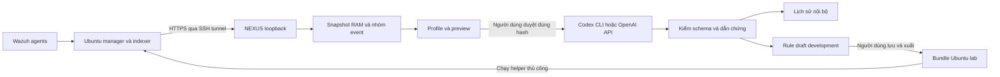

# Kiến trúc và giới hạn

## Module

| Module | Trách nhiệm |
|---|---|
| server.py | HTTP loopback, token, Host/Origin, cấu hình tại terminal và endpoints |
| indexer.py, intake.py, transfer.py | Truy vấn có giới hạn, parse, gom nhóm và tùy chọn lấy sample |
| privacy.py, context.py | Policy theo trường, HMAC và ngữ cảnh bổ sung có review |
| analysis.py | Cache snapshot/preview, xác nhận, lịch sử và lưu candidate development |
| llm.py, codex_cli.py | Adapter, kiểm JSON schema, dẫn chứng và xử lý lỗi |
| rules.py, bundle.py, lab_helper.py | Bản nháp, kiểm subset XML, xuất và thao tác trên lab |
| monitor.py | Polling tùy chọn; không tự gọi AI |
| core.py | Hồ sơ SQLite bất biến, evidence/run/candidate/check/supersede |

## Ranh giới

App bind 127.0.0.1 và dùng session token; chưa là giải pháp nhiều người dùng hoặc public hosting. Account Indexer cần quyền đọc thực tế: dùng account admin vẫn có quyền admin. HTTPS qua tunnel phải khớp CA và hostname của chứng chỉ.

Snapshot cache tối đa4 bản, preview tối đa16 bản, hết hiệu lực sau900 giây. Cache dọn khi có thao tác tiếp, không là cơ chế xóa vật lý theo thời gian thực. Mỗi preview gắn hash, cấu hình và policy; chỉ dùng một lần. Không tự thử lại sau timeout.

Codex chạy process riêng với environment allowlist, không kế thừa mật khẩu Indexer/API. Bridge dùng thư mục tạm, read-only/ephemeral/ignore-user-config và tắt các tính năng công cụ. Các cờ phụ thuộc phiên bản CLI; không thay thế sandbox hệ điều hành đã được kiểm định. Cache/auth/telemetry do Codex quản lý; ephemeral không cam kết không có dấu vết trên dịch vụ. NEXUS không đọc hoặc sao chép auth.json.

Trước lời gọi model, app lưu request đã duyệt và manifest; sau đó lưu kết quả hoặc mã lỗi. Định danh HMAC là giả danh, không mặc nhiên là dữ liệu công khai. Văn bản opt-in vẫn cần người đọc lại. Audit tại máy có thể bị người có quyền truy cập sửa, không phải sổ cái chống giả mạo.

Polling chạy30–3600 giây/lượt, tối đa8 giờ, cache5000 ID. Không có pagination hoặc checkpoint bền vững; cửa sổ bị giới hạn không bảo đảm lấy hết log. Thay đổi bộ lọc trong form không thay query polling đang chạy: dừng rồi bắt đầu lại để đổi query.

Helper Ubuntu chỉ được người dùng chạy bằng root với --confirm-lab. Nó khóa thao tác cùng helper, từ chối ghi đè target, kiểm ID và cấu hình, yêu cầu ba loại logtest phù hợp rồi mới restart manager. Lỗi restart hoặc file hash thay đổi cần kiểm tra thủ công; snapshot VM là điểm khôi phục bổ sung. App không dùng công cụ của model để triển khai.

Báo cáo run hiện dựa trên metadata người dùng nhập. Chưa tự tính technique coverage hoặc tỷ lệ cảnh báo giả. Kết quả AI và unit tests không thay thế đánh giá trên lab.

## Nguồn kỹ thuật

- [Wazuh custom rules](https://documentation.wazuh.com/current/user-manual/ruleset/rules/custom.html): thư mục custom rules, ID100000–120000, restart manager để sinh cảnh báo live.
- [wazuh-logtest](https://documentation.wazuh.com/current/user-manual/reference/tools/wazuh-logtest.html): -U kiểm rule/level/decoder cho một dòng log.
- [Codex non-interactive](https://learn.chatgpt.com/docs/non-interactive-mode): stdin, JSONL, schema, ephemeral và dùng lại phiên đăng nhập.
- [OpenAI Structured Outputs](https://developers.openai.com/api/docs/guides/structured-outputs): JSON schema; vẫn cần xử lý refusal/incomplete và kiểm nội dung.
