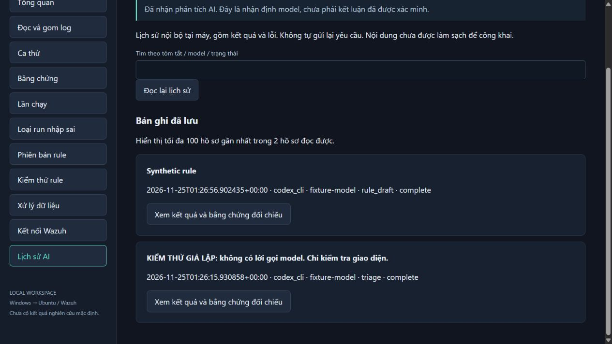

# Kiểm chứng bản lab — 25/11/2026

## Đã thực hiện

- Bộ unit/HTTP loopback chạy trên máy Windows với Python3.12; test không gọi AI hoặc Wazuh thật. Kết quả cuối tại máy:108/108 tests pass; CI công khai được kiểm riêng sau push.
- Cú pháp JavaScript và hai script PowerShell được kiểm tra. Launcher tương tác SSH/password chưa được chạy end-to-end trong lượt phát hành; các lệnh SSH/Python riêng vẫn dùng được.
- Đường đọc Wazuh Indexer từng lấy cảnh báo lab thật qua tunnel và TLS. Người dùng đã nhận triage Codex trên log thật, với insufficient_context do dữ liệu bị che; đây là bằng chứng kết nối, không phải hiệu quả phát hiện.
- Sau bổ sung context/rule schema, hai lượt Codex thật chỉ dùng JSON tổng hợp: triage trả JSON hợp lệ (8942 input/408 output tokens); rule_draft trả proposed hợp lệ (9020 input/375 output tokens). Có sử dụng hạn mức Codex, không dùng API key hoặc log Wazuh trong các smoke này.
- Browser fixture riêng: đọc dữ liệu giả, opt-in text/preview/consent, nhận triage mock, đổi sang rule_draft, lưu candidate, tải bundle, xem history và bật/dừng polling. Không coi kết quả mock là nhận định model.
- Helper Ubuntu kiểm bằng filesystem tạm và command mock: phát hiện ID trùng, load lỗi dọn candidate, chặn kích hoạt thiếu/failed checks, từ chối file hash thay đổi và thử đường rollback khi restart lỗi.

## Chưa được chứng minh

Chưa chạy stage/activate/rollback trên manager Ubuntu thật ở lượt phát hành. Chưa chạy tấn công, replay, bộ benign/held-out hoặc đo false positives/độ phủ/độ trễ. Unit tests, XML validation và một draft hợp lệ không chứng minh rule đúng trên engine Wazuh.

Polling chưa có pagination hoặc checkpoint bền vững, nên không thể tuyên bố thu đủ mọi event. Redaction không bảo đảm ẩn danh. Bridge Codex phụ thuộc phiên bản CLI và quyền tài khoản; không là một ranh giới cách ly đã được kiểm định độc lập.

Kết luận: bản phần mềm dành cho **kiểm thử lab có giám sát**, không phải chứng nhận production. Theo [checklist lab](LAB-ACCEPTANCE.md) trước khi công bố số liệu hoặc áp dụng ngoài lab.

## Giao diện kiểm thử giả lập

Ảnh dưới đây chỉ là kiểm tra UI bằng fixture/model mock, không phải dữ liệu lab hoặc kết quả phát hiện.

